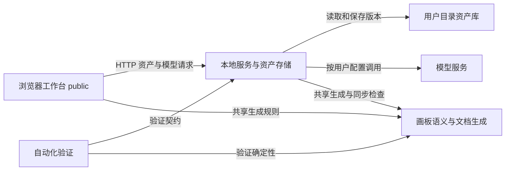

---
paths:
  - "**/*"
---

## 项目架构与本次扩展

### 架构图

### 定位与职责

本地网页资产管理应用；承接 Skill可视化编排、画板确定性文档生成、图文同步保存、Skill智能可视化转换、Skill文字变更同步画板。

### 内部组成

- 浏览器工作台：现有资产表单及独立画板编辑器；拥有未保存交互状态。
- 本地服务：拥有持久化、Git 版本及模型调用副作用，复用现有资产和模板配置。
- 画板语义与文档生成：无浏览器或文件副作用的共享模块；定义图结构、文档生成和建议性检查。
- 模型转换适配：统一转图与更新提示词、响应解析；不拥有资产写入。
- 自动化验证：证明图文转换、同步检查、历史与旧资产兼容。
- 模型协议适配：承接模型服务配置，隔离各协议的地址、鉴权、请求与文本响应；助手的所有 AI 调用复用同一入口。
- 目标软件模型配置：承接 Claude Code / Codex 自定义 API 生效，拥有配置预览、受管字段恢复与本机凭据辅助程序；模型凭据继续由本机私有存储拥有。

### 依赖与联动

浏览器与服务均依赖共享画板语义模块，避免两套生成规则。模型输出先解析为画板，再用同一生成器产生正文。每个 Skill 模板的图与正文共同进入已有版本存储，部署继续输出可独立阅读的 SKILL.md 与已有资源。

### 架构级约束与不变量

- 确定性生成不得依赖模型；模型不可用不影响直接画图和图改文。
- 语义检查是建议，数据不可解析、超限及图文未同步属于保护数据一致性的错误。
- 画板逻辑不执行图中步骤或引用脚本。
- 模型请求和失败不自动保存资产；保存权限仍由现有版本入口拥有。

### 技术选型

沿用 Node ES modules、原生 HTTP 和浏览器 DOM/SVG；画板使用独立 ES module 与 CSS，不引入新的前端框架。服务与浏览器共享纯函数。

### 非功能约束

用户文字必须转义后展示；可取消模型等待，迟到响应不得覆盖新编辑；结构限制防止异常模型输出拖垮画板。

### R11 实现边界

跨平台启动入口：macOS command 与 Linux shell 仅负责定位项目和发现 Node.js；scripts/launch.mjs 负责依赖检查、助手子进程生命周期、就绪探测和浏览器打开，以及 Linux 桌面快捷方式生成。启动器不拥有模型或资产配置写入，资产初始化仍由服务端负责。Windows cmd 保持现有行为。

协议适配与软件配置独立于画板转换。首期直连 Anthropic Messages、OpenAI Chat Completions、OpenAI Responses、Gemini generateContent；外部网关提供兼容端点时可覆盖目标软件地址与模型名。应用不内置完整转换网关，不将文本连通等同于 Agent 工具调用兼容。

Claude Code 与 Codex 均使用用户级配置。两者均先预览、后确认写入；本助手不在开发过程中修改当前运行的全局配置。目标配置通过凭据辅助程序读取本机 Key，不嵌入 Key。模型 API 配置生效与撤销仅管理生成字段，确认后覆盖这些字段的当前值，保留非受管字段；只有预览之后的变化要求重新预览。供应商模型列表发现模块只读取远端目录，不拥有资产保存；供应商持有列表及 AI 辅助模型，外部软件应用持有本次模型选择。旧项目覆盖由目标配置模块在预览确认后恢复。

R13：目标映射的纯函数负责校验应用时的模型列表、别名与目录能力；配置应用模块拥有生成目录文件及其恢复记录，和主配置共用预览令牌及回滚边界。浏览器仅收集与展示映射，不拥有请求改写代理，不修改桌面端会话数据库。
